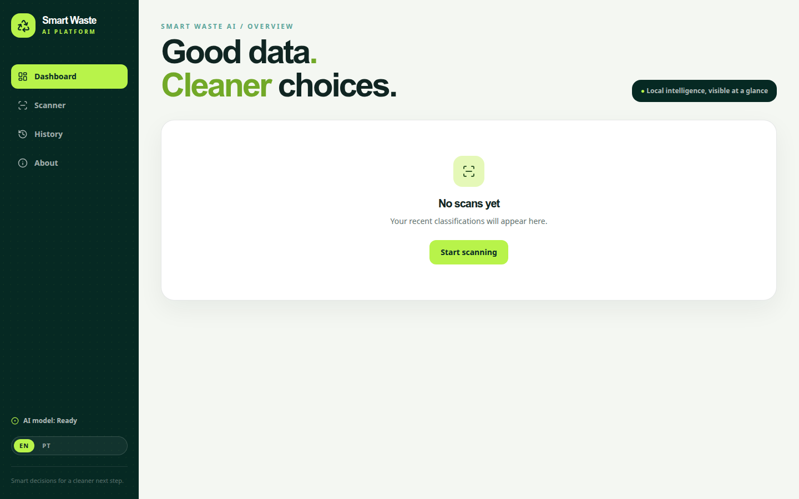
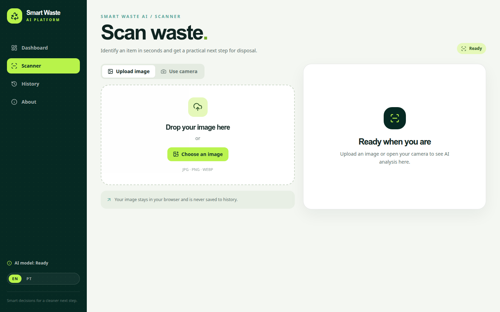

# Smart Waste AI

Smart Waste AI is a responsive browser application that classifies household waste from an uploaded image or a webcam frame. It combines a Teachable Machine image model, TensorFlow.js inference, a bilingual SaaS-style interface, and local analytics for a practical recycling workflow.





## What it does

- Classifies six waste classes: Cardboard, Glass, Metal, Paper, Plastic, and Trash.
- Supports JPG, JPEG, PNG, and WEBP uploads with drag-and-drop.
- Supports webcam preview, frame capture, permission errors, and complete stream cleanup.
- Shows sorted probabilities and confidence tiers: High (85%+), Medium (65–84%), and Low (below 65%).
- Explains recyclability, examples, and disposal guidance while noting that municipal rules vary.
- Stores classification metadata in LocalStorage without storing images.
- Provides Dashboard, Scanner, History, and About pages.
- Starts in English and can switch to Portuguese (EN/PT), with the preference persisted locally.
- Includes a mock model for development and a real TensorFlow.js model mode.

## How the AI was made

The model workflow used for this project is:

```text
Kaggle waste images
        ↓
Six curated classes
        ↓
Google Teachable Machine Image Project
        ↓
TensorFlow.js export
        ↓
Smart Waste AI in-browser inference
```

The image dataset was based on the [Garbage Dataset on Kaggle](https://www.kaggle.com/dsv/10182596), filtered to the six classes required by this app. The model was trained/exported with [Google Teachable Machine](https://teachablemachine.withgoogle.com/train) as a TensorFlow.js image model.

### Model classes

| Class | Examples | Recycling note |
| --- | --- | --- |
| Cardboard | Boxes, packaging, cardboard containers | Usually recyclable when clean and dry |
| Glass | Bottles, jars, glass containers | Separate and follow local collection guidance |
| Metal | Cans, aluminum containers, metal packaging | Empty and rinse when applicable |
| Paper | Newspapers, office paper, magazines | Keep dry and clean |
| Plastic | PET bottles, containers, packaging | Rinse and check local accepted plastics |
| Trash | Contaminated, mixed, or non-recyclable waste | Follow the local general-waste rules |

The classifier is an assistive suggestion, not a universal disposal authority. Recycling acceptance and disposal instructions vary by municipality.

## Tech stack

- React 18 + TypeScript
- Vite
- Tailwind CSS 3
- TensorFlow.js and `@teachablemachine/image`
- React Router
- Lucide React
- Recharts
- Vitest and Testing Library
- LocalStorage for initial persistence

## Run locally

Requirements: Node.js 18+ and npm.

```bash
npm install --legacy-peer-deps
npm run dev
```

Open the local URL printed by Vite, normally `http://127.0.0.1:5173` or `http://127.0.0.1:5174` when another Vite server is already using the first port.

### Mock model

```env
VITE_USE_MOCK_MODEL=true
```

Mock mode is useful before exporting a model. To switch back to it, create or edit `.env.local` and restart Vite.

### Install the real model

Export the model from Teachable Machine using **Export Model → TensorFlow.js → Download my model**. Extract the ZIP and copy its files into:

```text
public/model/
├── model.json
├── metadata.json
└── weights.bin
```

Then set:

```env
VITE_USE_MOCK_MODEL=false
```

The app loads `/model/model.json` and `/model/metadata.json` once per browser session. If the files are unavailable, the interface remains navigable and displays a recovery message.

## Project structure

```text
src/
├── components/       Reusable layout, scanner, prediction, and dashboard UI
├── contexts/         Language, history, and model providers
├── data/             Bilingual waste information
├── hooks/            Model and webcam lifecycle hooks
├── i18n/             English and Portuguese interface copy
├── pages/            Dashboard, Scanner, History, and About routes
├── services/         TensorFlow.js and LocalStorage boundaries
├── types/            Classification, prediction, waste, and model types
└── utils/            Confidence and date formatting
```

TensorFlow.js is isolated in `src/services/modelService.ts`; components consume normalized predictions without knowing model internals.

## Quality checks

```bash
npm run lint
npm run test:run
npm run build
```

## Deploy

This is a static Vite application. It can be deployed to GitHub Pages, Vercel, Netlify, Cloudflare Pages, or any static host.

```bash
npm run build
```

Publish the generated `dist/` folder. For Vercel/Netlify, use `npm run build` as the build command and `dist` as the output directory. Configure `VITE_USE_MOCK_MODEL=false` and include `public/model/` in the deployment.

## Privacy

Images are processed in the browser and are not sent to a backend. Preview object URLs are revoked when replaced or when the Scanner is unmounted. Only classification metadata—material, probabilities, source, and timestamp—is persisted in LocalStorage.

## License and dataset note

Review the license and attribution requirements of the Kaggle dataset used for training before distributing a production model. This repository contains the exported model needed by the demo; the original training images are not redistributed here.
